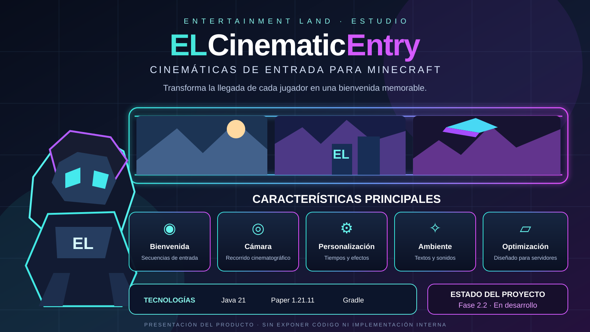

# ELCinematicEntry

  

  <strong>Haz que cada llegada sea una experiencia.</strong> 
  Sistema de entrada cinematográfica desarrollado para Entertainment LAND.

  
  
  
  
  

  ¿Prefieres leerlo en inglés?
  <a href="https://translate.google.com/translate?sl=es&tl=en&u=https%3A%2F%2Fgithub.com%2Fdaigorogo94%2FELCinematicEntry">Traducir esta página con Google Translate</a>

---

## ¿Qué es ELCinematicEntry?

**ELCinematicEntry** es un complemento personalizado para servidores Minecraft que transforma el momento en que un jugador ingresa al servidor en una bienvenida cinematográfica.

El proyecto prioriza la presentación visual, las transiciones fluidas y una identidad audiovisual configurable, manteniendo en cuenta la integración con el servidor y la experiencia del jugador.

## Características principales

- Secuencia de bienvenida cinematográfica con presentación de cámara.
- Títulos y subtítulos personalizables.
- Duración configurable de los mensajes en pantalla.
- Perfiles de efectos visuales y ambiente sonoro.
- Controles para que el jugador gestione la experiencia.
- Desarrollo por etapas para ampliar la compatibilidad entre plataformas.

## Tecnologías utilizadas

El proyecto se apoya en tecnologías conocidas del ecosistema de servidores Minecraft:

| Tecnología | Uso general |
|---|---|
| **Java 21** | Plataforma de ejecución y desarrollo |
| **Paper API 1.21.11** | Integración con el servidor Minecraft |
| **Gradle Kotlin DSL 8.14.3** | Gestión de compilación y dependencias |
| **PacketEvents 2.11.1** | Capa de compatibilidad de comunicación con clientes |

Se mencionan únicamente tecnologías generales. No se publican la arquitectura interna, el código fuente, las clases, la lógica de funcionamiento ni las configuraciones privadas del producto.

## Versiones y plataformas

| Componente | Compatibilidad / estado |
|---|---|
| **Minecraft Java Edition 1.21.11** | Plataforma objetivo de esta versión |
| **Paper 1.21.11** | Servidor objetivo |
| **Java 21** | Requisito de ejecución y compilación |
| **Gradle 8.14.3** | Versión utilizada para compilar |
| **PacketEvents 2.11.1** | Dependencia obligatoria |
| **Geyser-Spigot / Floodgate** | Dependencias opcionales detectadas; no implican compatibilidad de cámara Bedrock validada |

**Importante:** la cámara cinematográfica de la versión actual fue validada en clientes Java durante las pruebas del proyecto. La compatibilidad específica de cámara para Bedrock está prevista para una fase posterior y no debe considerarse disponible hasta completar sus pruebas.

## Estado del desarrollo

- **Fase 1:** detección de entrada, preferencias del jugador y controles básicos.
- **Fase 2.1:** experiencia de cámara cinematográfica; movimiento fluido validado en pruebas.
- **Fase 2.2:** personalización audiovisual, títulos, partículas y sonidos.
- **Próxima etapa:** investigación y validación específica de la cámara para Bedrock.

Las funciones planificadas se identifican como desarrollo futuro y no como características ya certificadas.

## Galería visual

  

La galería presenta el concepto visual, las funciones generales y las tecnologías del producto. Se ampliará con capturas reales y demostraciones seleccionadas conforme avance el desarrollo.

## Distribución y propiedad

ELCinematicEntry es un producto comercial propietario desarrollado para Entertainment LAND.

- Este repositorio es un escaparate público del producto, no un repositorio de código fuente.
- No se distribuyen archivos JAR compilados desde aquí.
- La consulta de este repositorio no concede permiso para copiar, modificar, redistribuir, sublicenciar o revender el complemento.
- El acceso comercial y las licencias son gestionados por el propietario del proyecto.

Para consultas comerciales o de licenciamiento, utiliza los canales oficiales de Entertainment LAND.

---

  © 2026 Entertainment LAND · ELCinematicEntry · Todos los derechos reservados.

