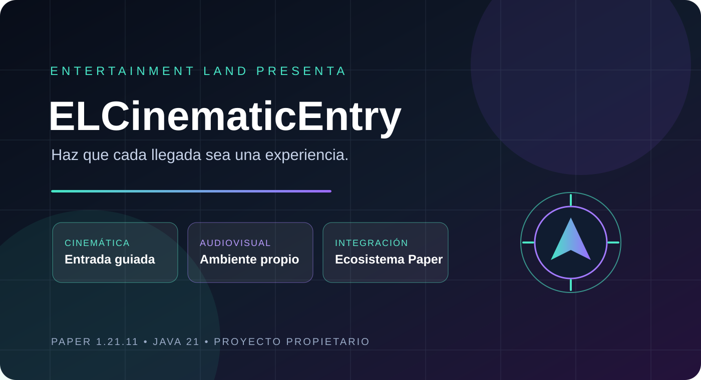

# ELCinematicEntry

  

  <strong>A more memorable first impression for every player.</strong> 
  Cinematic arrival experiences developed for Entertainment LAND.

  
  
  
  

---

## About the project

**ELCinematicEntry** is a custom Minecraft server experience designed to transform the moment a player joins into a polished, cinematic welcome.

The project focuses on presentation, smooth visual transitions and configurable audiovisual identity, while keeping server integration and player experience in mind.

## Experience highlights

- Cinematic arrival sequence with a guided camera presentation.
- Customizable title and subtitle presentation.
- Adjustable timing for on-screen messages.
- Visual-effect profiles and configurable sound atmosphere.
- Player controls to manage the experience.
- Development roadmap for broader client compatibility.

## Technology overview

The project is built around established technologies from the Minecraft server ecosystem:

| Technology | Project role |
|---|---|
| **Java 21** | Runtime and development platform |
| **Paper API 1.21.11** | Minecraft server integration |
| **Gradle Kotlin DSL** | Build and dependency management |
| **PacketEvents** | Networking compatibility layer |
| **Geyser / Floodgate** | Cross-platform compatibility considerations |

This overview intentionally stays at product level. Internal implementation, source structure, detailed configuration and proprietary development methods are not published.

## Development status

- **Phase 1** — Core welcome sequence and player preferences.
- **Phase 2.1** — Cinematic camera experience; smooth movement validated in server testing.
- **Phase 2.2** — Audiovisual customization and presentation profiles.
- **Next milestone** — Dedicated Bedrock camera compatibility validation.

Compatibility statements refer only to features that have been tested. Planned work is identified as such.

## Product preview

The repository includes project artwork and selected preview material. Demonstrations are representative of the development environment and may change as the product evolves.

## Distribution and licensing

ELCinematicEntry is a proprietary commercial project developed for Entertainment LAND.

- This repository is a public product showcase, not a source-code distribution.
- No compiled plugin JARs are published here.
- No license to reproduce, modify, redistribute, sublicense or resell the plugin is granted by viewing this repository.
- Commercial access and licensing are managed by the project owner.

For product information, licensing or partnership inquiries, contact the Entertainment LAND team through its official channels.

---

  © 2026 Entertainment LAND · ELCinematicEntry · All rights reserved.

